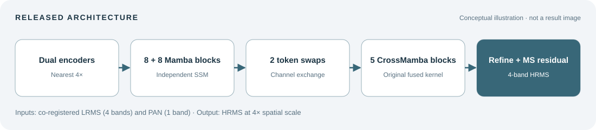

<div align="center">

# Pan-Mamba

### Pan-Mamba: Effective pan-sharpening with state space model

**Information Fusion · 2025 · Official research implementation**

Xuanhua He, Ke Cao, Jie Zhang, Keyu Yan, Yingying Wang, Rui Li, Chengjun Xie, Danfeng Hong, Man Zhou

[Paper](https://doi.org/10.1016/j.inffus.2024.102779) · [arXiv](https://arxiv.org/abs/2402.12192) · [Modern implementation](modern/README.md) · [Project website source](docs/) · [Compatibility CI](https://github.com/alexhe101/Pan-Mamba/actions/runs/45547608938)

[](https://github.com/alexhe101/Pan-Mamba/actions/workflows/modern-pytorch.yml)

</div>



## Overview

A state-space network for long-range multispectral and panchromatic feature interaction. The released model combines independent feature extraction, channel swapping, sequential shallow fusion and cross-modal Mamba.

## Compatibility-first release

The new standalone package under `modern/` is derived from the exact public release, not a new architecture. The original implementation and experiment configuration are retained.

- Preserve the original fixed 32-channel architecture, all parameter and buffer names (including unused registered tensors), the 8+8 independent Mamba blocks, 2 swap blocks and 5 cross-modal blocks.
- Preserve **nearest** 4× upsampling (the historical variable is named `ms_bic`), double normalization, sequential MS/PAN shallow fusion, both state-space branches and residual order.
- Split the effective layers and Mamba blocks into modules. Ship the exact released fork from `Mamba-block/mamba_simple.py` locally; only two invalid optional-import assignments are corrected. No changes to the SSM equations or fused kernels.
- Pass actual height and width to the cross-modal reshape. On the originally hardcoded 1024×1024 grid this is the same view; smaller/non-square inputs are an explicit shape-compatibility extension, not a different fusion algorithm.
- Missing CUDA kernels raise an error; no silent substitute, no Mamba-2, no changing `use_fast_path`. CPU-only test recurrence is never used by production.

## Quick start

```bash
git clone https://github.com/alexhe101/Pan-Mamba.git
cd Pan-Mamba
git switch refactor/modern-pytorch
```

First install the original Vim-compatible CUDA extensions using [the environment guide](modern/README.md#cuda-environment). Do not replace the local Mamba fork with a generic implementation.

```bash
python -m pip install -e './modern[dev]'
python -m pytest modern/tests -v -rs
```

```python
from panmamba import build_model, load_weights, predict
import torch

model = build_model(device="cuda").eval()
load_weights(model, "pan-sharpening/checkpoint/pretrained/Mamba/mambawv2/bestPSNR.pth")
ms = torch.rand(1, 4, 32, 32, device="cuda")
pan = torch.rand(1, 1, 128, 128, device="cuda")
with torch.inference_mode():
    hrms = predict(model, ms, pan)
```

The above uses random inputs for an API demonstration only. Follow [data and radiometry conventions](modern/README.md#input-and-output-contract) for real data.

```bash
panmamba infer --device cuda --checkpoint pan-sharpening/checkpoint/pretrained/Mamba/mambawv2/bestPSNR.pth --input scene.npz --output result.npz
panmamba train --device cuda --data paired_train --output runs/train
```

## Weights and reproducibility

The three original .pth files are kept byte-for-byte in their original paths. The loader supports the released `net` wrapper and DataParallel `module.` prefix and uses `strict=True`. No parameter migration, padding, truncation or `strict=False` is used. Checkpoint files contain NumPy training metadata; newer PyTorch can allow only known scalar/dtype types in a scoped safe unpickler. On older PyTorch, use `--trusted-checkpoint` (or `trusted_pickle=True`) only for a checkpoint you independently trust, or export a tensor-only state dict using a compatible modern environment. Never enable unrestricted pickle for unknown files.

| Sensor | Published checkpoint |
|:--|:--|
| GF2 | [bestPSNR.pth](pan-sharpening/checkpoint/pretrained/Mamba/mambagf2/bestPSNR.pth) |
| WV2 | [bestPSNR.pth](pan-sharpening/checkpoint/pretrained/Mamba/mambawv2/bestPSNR.pth) |
| WV3 | [bestPSNR.pth](pan-sharpening/checkpoint/pretrained/Mamba/mambawv3/bestPSNR.pth) |


## Research results

| Dataset | PSNR ↑ | SSIM ↑ | SAM ↓ | ERGAS ↓ |
|:--|--:|--:|--:|--:|
| WorldView-II | 42.2354 | 0.9729 | 0.0212 | 0.8975 |
| Gaofen-2 | 47.6453 | 0.9894 | 0.0103 | 0.5286 |
| WorldView-III | 31.1551 | 0.9299 | 0.0702 | 2.8942 |

Published preprint v2, Table 1 (reduced-resolution Wald protocol). These are the original reported values, not new measurements of the refactor.

[Original result source](https://arxiv.org/html/2402.12192v2#S4) · [Figures 2–4 in preprint PDF](https://arxiv.org/pdf/2402.12192v2)

## Validation and scope

The CPU suite checks published source hashes, all three tracked checkpoint hashes, exact parameter-name/shape compatibility, strict checkpoint loading, and old/new predictions under a common **test-only** PyTorch SSM reference at 8×12 HR. This is not a fused CUDA benchmark, nor reproduction of the publication's metrics.

Mandatory before merging a release that claims full numerical parity:

```bash
# On a GPU with the original compatible fused extensions:
PANMAMBA_TEST_CUDA=1 PANMAMBA_TEST_SIZE=128 python -m pytest modern/tests/test_release_parity.py -v -s
# For exact comparison against the original hardcoded 1024×1024 reshape:
PANMAMBA_TEST_CUDA=1 PANMAMBA_TEST_SIZE=1024 python -m pytest modern/tests/test_release_parity.py -v -s
```

The smaller size uses only a shape adaptation in the legacy reference; the 1024 test retains the published view dimensions. Both execute the same fused kernels. Use sufficient VRAM for the 1024 test. The CUDA checks fail rather than skip when explicitly requested. Full-data benchmark metrics also require the original test data/protocol, which are not distributed.

[CI record](https://github.com/alexhe101/Pan-Mamba/actions/runs/45547608938). Full dataset reproduction and GPU performance are not claimed by the refactor.

## Repository layout

| Path | Purpose |
|:--|:--|
| [modern/src/panmamba/](modern/src/panmamba/) | Modular implementation |
| [modern/tests/](modern/tests/) | Release and checkpoint regression |
| [modern/README.md](modern/README.md) | Installation, data, compatibility details |
| [pan-sharpening/model/panmamba_baseline_finalversion.py](pan-sharpening/model/panmamba_baseline_finalversion.py) | Untouched original model |
| [pan-sharpening/option.yml](pan-sharpening/option.yml) | Untouched original training configuration |
| [docs/](docs/) | Static project website |

The legacy training entry point is `pan-sharpening/main.py`; the original testing script is `pan-sharpening/test.py`. Configure paths and the historical dependencies before using them. The original training data are not distributed.

## Citation

```bibtex
@article{he2025panmamba,
  title = {Pan-Mamba: Effective pan-sharpening with state space model},
  author = {He, Xuanhua and Cao, Ke and Zhang, Jie and Yan, Keyu and Wang, Yingying and Li, Rui and Xie, Chengjun and Hong, Danfeng and Zhou, Man},
  journal = {Information Fusion},
  volume = {115},
  pages = {102779},
  year = {2025},
  doi = {10.1016/j.inffus.2024.102779}
}
```
